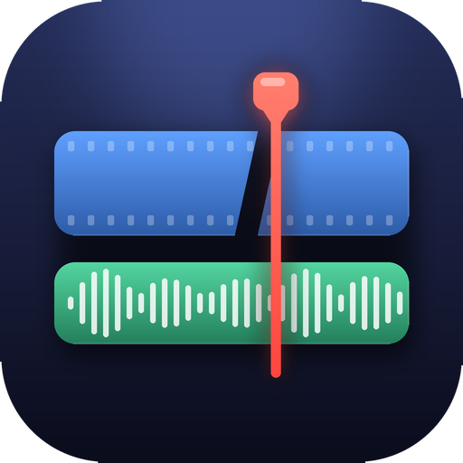

<p align="center">
  
</p>

<h1 align="center">MiniCut</h1>

<p align="center">
  A minimalistic, native video and audio editor: import, drag onto a timeline, trim, split, export.<br>
  Written in Go with <a href="https://fyne.io">Fyne</a>. No web view, no Electron. <a href="https://ffmpeg.org">ffmpeg</a> does the media work.
</p>

<p align="center">
  <a href="https://github.com/OWNER/minicut/actions/workflows/build.yml"></a>
  
</p>

---

## Features

- **Media library** with a *Video* and an *Audio* folder. Import (several files at once) with the **system file dialog**, or drop files on the window.
- **Two-lane timeline**: drag clips in from the library, **trim by dragging a clip's edges**, move clips to any
  position, **split a clip in two at the playhead**, mute each lane. The audio lane is free-form and can overlap
  (overlapping clips are mixed) and is mixed over the sound of the video clips.
- **Two monitors**: the *Media monitor* previews library items; the *Timeline player* plays the cut result with sound.
- **Export** to Matroska (`.mkv`, or `.mka` for audio only): H.264 or H.265, bitrate or CRF, 2-pass, preset, tune,
  10-bit, GOP, resolution, frame rate, AAC / Opus / FLAC, plus free-form extra ffmpeg arguments.
- **GPU encoding**: NVIDIA NVENC, Intel Quick Sync, AMD AMF, Apple VideoToolbox (detected automatically).
- Reads whatever ffmpeg reads (mkv, mp4, mov, avi, webm, ts, mp3, flac, wav, ...).
- Dark theme, responsive layout (monitors grow with the window), timeline *fit mode* (a 3-hour project fits
  without a scroll bar), adjustable UI size, full screen on F11.
- Cancel really stops the encode (ffmpeg and everything it started).
- **Windows installer that includes ffmpeg**, and a portable zip (see [Installer](#installer)).

## Requirements

| What | Why |
|------|-----|
| [Go](https://go.dev/dl/) 1.21+ | to build |
| A C compiler | Fyne draws with OpenGL through cgo |
| [ffmpeg](https://ffmpeg.org/download.html) + `ffprobe` (and optionally `ffplay`) | media work; `ffplay` only plays the sound during previews |

MiniCut uses an ffmpeg that sits **next to its executable** first, then the one in your `PATH`.
(The installer puts ffmpeg next to `minicut.exe`, so nothing else has to be installed.)

C compiler / system libraries:

- **Windows**: MinGW-w64 (`winget install BrechtSanders.WinLibs.POSIX.UCRT`, or MSYS2 `pacman -S mingw-w64-ucrt-x86_64-gcc`, or `choco install mingw`)
- **macOS**: `xcode-select --install`
- **Linux (Debian/Ubuntu)**: `sudo apt install gcc libgl1-mesa-dev xorg-dev`
  (Fedora: `gcc libXcursor-devel libXrandr-devel mesa-libGL-devel libXi-devel libXinerama-devel libXxf86vm-devel`)
- **Linux, system file dialogs**: install `zenity` (GNOME) or `kdialog` (KDE). Without them MiniCut falls back to its built-in dialogs.

## Build

```sh
git clone https://github.com/OWNER/minicut.git
cd minicut
go mod tidy          # first time only: fetches Fyne and writes go.sum
```

| OS | Command | Result |
|----|---------|--------|
| Windows | `build.bat` | `minicut.exe` with the app icon, no console window |
| Linux / macOS | `./build.sh` | `./minicut` |
| any | `go build -o minicut ./cmd/minicut` | plain build (on Windows add `-ldflags "-H=windowsgui"`) |

The first build takes a few minutes (it compiles the OpenGL/window code); later builds are fast.

## Using MiniCut

```
┌───────────────────────┬───────────────────────┐
│ Media monitor         │ Timeline player       │   monitors grow with the window
├───────────────────────┴───────────────────────┤
│ Timeline   [video lane] [audio lane]          │
├───────────────────────┬───────────────────────┤
│ Media library         │ Export settings,      │   two cards of the same size
│  Video | Audio        │ Save as, progress     │
└───────────────────────┴───────────────────────┘
```

1. **Import** in the *Media library*: *Import video…* / *Import audio…* (the operating system's file dialog opens; you can select several files), or drop files on the window.
   Click an item to preview it in the *Media monitor*.
2. **Drag an item onto the timeline** (a ghost shows where it lands) or double-click it to append it.
   Audio-only files go on the audio lane; video files can go on either lane (on the audio lane only their sound is used).
3. **Cut on the timeline.**

   | Action | How |
   |--------|-----|
   | Trim | drag the left or right **edge** of a clip |
   | Move | drag the clip body. Video lane: drop it between any two clips (the others close up). Audio lane: free position, snaps to neighbours |
   | Split | put the playhead where you want to cut and press **Split** (next to *Play timeline*) or **Split at playhead** (or `S`): the clip becomes two clips. A selected clip is cut if the playhead is inside it, otherwise every clip under the playhead is cut (video and audio lane) |
   | Remove | select a clip, press **Remove** or `Delete` |
   | Exact audio position | select an audio clip, type a time in *Audio clip starts at* |
   | Preview a clip's source | double-click the clip |
   | Move the playhead | click/drag the ruler or empty lane space; slider or time box under the *Timeline player*; `−1s −.1 +.1 +1s`; `\|◀` `▶\|` jump to the previous/next cut |
   | Zoom | `−` / `+`; **Fit** turns fit mode back on (the whole project always visible, no scroll bar) |

4. **Export** (lower right): choose settings, *Save as* (system dialog), **Export**. Progress is shown below; **Cancel** stops it.

Keyboard (when no text box has focus): `←` `→` step the media monitor, `S` split, `Delete` remove, `F11` full screen.
With the timeline focused (after clicking it): `←` `→` move the playhead 1 s, `Home` / `End`, `S`, `Delete`.

The video lane has no gaps: clips follow each other. The audio lane can have gaps.

### GPU encoding

*Export → Encoder* offers **CPU (x264 / x265)** and, a moment after start-up, every GPU encoder that really works on
your computer (ffmpeg must contain it *and* a short test encode must succeed).

| Option | ffmpeg encoders |
|--------|-----------------|
| NVIDIA NVENC | `h264_nvenc`, `hevc_nvenc` |
| Intel Quick Sync | `h264_qsv`, `hevc_qsv` |
| AMD AMF | `h264_amf`, `hevc_amf` |
| Apple VideoToolbox | `h264_videotoolbox`, `hevc_videotoolbox` |

Notes: a recent GPU driver and an ffmpeg build with hardware encoders are needed (on Windows, the "full" build from
gyan.dev). *Preset* is mapped to each vendor's presets. *CRF* becomes the vendor's constant-quality mode, so the
numbers are not identical to x264/x265 CRF. *Tune* and *2-pass* are CPU-only, and 10-bit needs H.265.
GPU files are usually a little larger than x264/x265 at the same quality. Timeline previews always use the CPU.

### Screen size and resolution

The two monitors keep a 16:9 shape and take all the height the timeline and the bottom row do not need, so the same
window fits a 1080p screen and uses a 4K one. Fyne follows the display scaling of your OS; if the interface is too big
or small for a monitor, choose **UI size** in the menu bar (75 % … 200 % or *Automatic*) and restart
(the program offers to). The choice is saved in your user config folder (`minicut/uiscale.txt`).

## Installer

For delivery to people who just want to run it, build the Windows installer, which **includes ffmpeg**:

```bat
installer\build-installer.bat
```

This builds `minicut.exe`, downloads ffmpeg once, and writes `dist\MiniCut-Setup-<version>.exe` (per-user install,
Start menu and optional desktop shortcut, uninstaller) and `dist\MiniCut-portable.zip` (unzip and run).
You need [Inno Setup 6](https://jrsoftware.org/isinfo.php) on the build machine. Pushing a tag like `v1.1.0` builds
and publishes both files on GitHub Releases (`.github/workflows/release.yml`). Details and the FFmpeg (GPLv3)
license note: [installer/README.md](installer/README.md).

## Project structure

```
minicut/
├── cmd/minicut/              the application (package main)
│   ├── main.go               window, layout, menus, export
│   ├── timeline.go           custom timeline widget: lanes, trimming, drag & drop, playhead
│   ├── library.go            media library (folders, draggable items, import)
│   ├── dialogs.go            system file dialogs (zenity) with Fyne fallback
│   ├── player.go             media monitor and timeline player
│   ├── encode.go             project model, validation, ffmpeg filter graph, export runner
│   ├── hw.go                 GPU encoder detection and arguments
│   ├── media.go              ffprobe and preview frames
│   ├── layouts.go            responsive layouts
│   ├── procutil.go           child processes: hidden console, kill the whole process tree
│   ├── proc_windows.go       Windows specifics
│   ├── proc_other.go         Linux / macOS specifics
│   ├── logic_test.go         unit tests
│   └── icon.png              app icon (embedded into the program)
├── assets/windows/           icon.ico + app.rc: icon of minicut.exe
├── installer/                Windows installer with ffmpeg (Inno Setup) + portable zip
├── tools/make_icon.py        regenerates the icon (Pillow + NumPy)
├── docs/ARCHITECTURE.md      how it works inside
├── .github/workflows/        CI: build and test on Linux, Windows, macOS
├── build.bat, build.sh       build scripts
├── CHANGELOG.md  CONTRIBUTING.md  LICENSE
└── go.mod
```

## How it works (short)

Every action builds one ffmpeg command: each clip becomes an input with `-ss/-t`, a filter graph scales and joins
the video lane (`concat`), delays and mixes the audio (`adelay`, `amix`), and the result is encoded to Matroska.
Previews use the same graph at 960×540 and stream raw frames into the monitors. Details in
[docs/ARCHITECTURE.md](docs/ARCHITECTURE.md).

## Troubleshooting

- **"ffmpeg not found"** – use the installer (it includes ffmpeg), or install ffmpeg and add it to `PATH`, or copy `ffmpeg` and `ffprobe` next to MiniCut.
- **A GPU encoder is missing from the list** – update the GPU driver, and check that your ffmpeg build contains it
  (`ffmpeg -encoders | findstr nvenc` on Windows, `ffmpeg -encoders | grep nvenc` elsewhere).
- **No sound in previews** – `ffplay` (part of ffmpeg) is needed for the sound.
- **Build error about a C compiler / `build constraints exclude all Go files`** – install the C compiler for your OS
  (see *Requirements*) and make sure `go env CGO_ENABLED` prints `1`.
- **Interface too big or too small** – menu *UI size*.
- **The file dialog looks like MiniCut's own, not the system one (Linux)** – install `zenity` or `kdialog`.

## Contributing

Issues and pull requests are welcome, see [CONTRIBUTING.md](CONTRIBUTING.md).

## License

[MIT](LICENSE)
